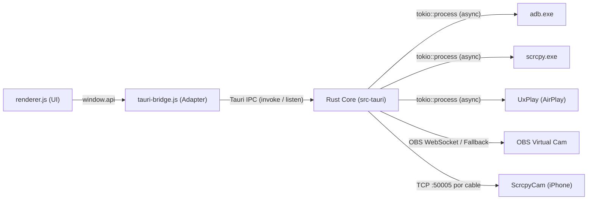

# Análisis y Arquitectura de scrcpy GUI

## 1. Qué es el proyecto

El repositorio `scrcpy-master` contiene el motor oficial de **scrcpy (v4.1, C + Java)** junto con una interfaz gráfica y herramientas complementarias:

| Pieza | Ubicación | Stack Tecnológico | Función |
|---|---|---|---|
| **GUI de escritorio** | `gui/` y `gui/src-tauri/` | Rust (Tauri v2) + WebView2 + HTML5/CSS/JS | Frontend nativo ultraligero de control para scrcpy / adb / UxPlay / OBS |
| **App iOS ScrcpyCam** | `gui/ios/ScrcpyCam` | SwiftUI + AVFoundation + VideoToolbox | Cámara de iPhone → H.264 → TCP :50005 |
| **Motor de captura Android** | `server/` | Java (Android Runtime / `app_process`) | Servidor scrcpy inyectado por ADB en Android |
| **Motor de cliente scrcpy** | `app/` | C (SDL2 + FFmpeg libavcodec/libavformat) | Decodificación por hardware y ventana SDL2 |

### Flujos principales:
- **Android:** Detección paralela mediante `adb devices` → Mirror / Cámara / Captura / Grabar → `scrcpy.exe` con argumentos calculados en Rust según Presets y Ajustes.
- **WiFi:** Emparejamiento (`adb pair`), conexión directa (`adb connect`) o conversión automática desde USB (`adb tcpip 5555`).
- **iPhone AirPlay:** Ejecución en segundo plano de UxPlay con activación opcional de OBS Virtual Camera.
- **iPhone USB:** Túnel de streaming local hacia la aplicación iOS ScrcpyCam.

---

## 2. Arquitectura del Backend en Rust (`gui/src-tauri/src/`)

El backend sustituye al antiguo `main.js` de Electron y está modularizado de forma asíncrona mediante **Tokio**:

| Módulo | Responsabilidad |
|---|---|
| **`tools.rs`** | Búsqueda y validación de ejecutables (`scrcpy.exe`, `adb.exe`, `uxplay.exe`, `obs64.exe`) inspeccionando recursivamente directorios ancestros (`vendor/`) y PATH del sistema. Manejo de comprobación de versiones contra GitHub Releases. |
| **`adb.rs`** | Ejecución asíncrona y segura de ADB con `CREATE_NO_WINDOW`, parsing paralelo de propiedades de dispositivos (`getprop`, batería, IP), deduplicación de interfaces (USB/mDNS/WiFi) y operaciones de red. |
| **`scrcpy.rs`** | `ScrcpyManager` con control de concurrencia (`Arc<Mutex<HashMap>>`), resolución óptima de resoluciones de cámara (`--list-camera-sizes`), streaming en vivo de stdout/stderr para eventos de textura (`scrcpy:texture`) y recuperación de microcortes Wi-Fi. |
| **`iphone.rs`** | Ciclo de vida del proceso UxPlay con drenado de buffers para evitar bloqueos y control de OBS Studio. |
| **`commands.rs`** | Comandos `#[tauri::command]` expuestos al frontend a través del puente IPC. |
| **`lib.rs`** | Inicialización de Tauri v2, System Tray con menú contextual nativo y control de eventos de ventana (minimizar a la bandeja). |

---

## 3. Histórico de bugs y correcciones resueltas

### 🔴 Críticos
- **C1 (Info.plist iOS):** Sustituido `$(EXECUTABLE_NAME)` por nombre estático `ScrcpyCam`; añadidos `MinimumOSVersion` (16.0) y `UIDeviceFamily`.
- **C2/C3 (Cámara USB iPhone):** Eliminada la doble conexión de socket conflictiva; ahora se mantiene un único forwarder local `tcp://127.0.0.1:50005` para OBS.
- **C4 (UxPlay orientación):** Eliminado el flag `-p` que activaba puertos legacy en lugar de rotación.
- **C5 (UxPlay congelamiento):** Drenado activo de stdout/stderr mediante buffers acotados (16 KB) evitando saturación del pipe.

### 🟠 Altos
- **A1 (Race condition en reinicio):** Implementado guard de generación y proceso activo (`SessionControl.generation`) para que el `exit` de un proceso viejo no borre una sesión recién iniciada.
- **A2 (Selectores iPhone):** Aislamiento de selectores en el DOM para evitar interferencias cruzadas entre modo de cámara y tipo de conexión.
- **A3 (Botón Iniciar):** Preservado el id `btnStartIphoneLabel` al cambiar etiquetas de estado.
- **A4 (Cancelación en Grabar):** Manejo explícito de cancelación del diálogo de guardado.
- **A5 (Estabilidad usbmux):** Detección silenciosa y única de fallos de servicio Apple Mobile Device sin excepciones no capturadas.
- **A6 (Ajustes durante reinicio):** Cola `settingsPendingCommit` para no descartar cambios de calidad mientras la cámara se reinicia.

### 🟡 Medios (Seguridad y Rendimiento)
- **Eliminación de inyecciones de comandos:** Ejecución de ejecutables mediante argumentos vectoriales estructurados sin invocación de shell (`cmd.exe`).
- **Paralelismo ADB:** Consultas de propiedades de dispositivos ejecutadas en paralelo (`tokio::join!` y `futures::future::join_all`).
- **Límite de memoria:** Buffers de log limitados a 16 KB rotativos para evitar fugas de memoria en sesiones prolongadas.

---

## 4. Migración de Arquitectura: Electron → Rust (Tauri v2)

| Factor | Anterior (Electron 44) | Actual (Rust + Tauri v2) |
|---|---|---|
| **Motor de UI** | Chromium embebido por la app | WebView2 nativo de Windows |
| **Consumo RAM en reposo** | ~180 – 250 MB | **~30 – 35 MB** |
| **Tamaño de descarga base** | ~180 MB | **~14 MB** |
| **Inicio de la aplicación** | 1.8 – 2.5 s | **< 0.3 s** |
| **Seguridad de procesos** | Node.js `child_process` | Tokio async con tipado estricto y sin shell |
| **Dependencias en `node_modules`** | 315 paquetes | **3 paquetes** (CLI de compilación) |
