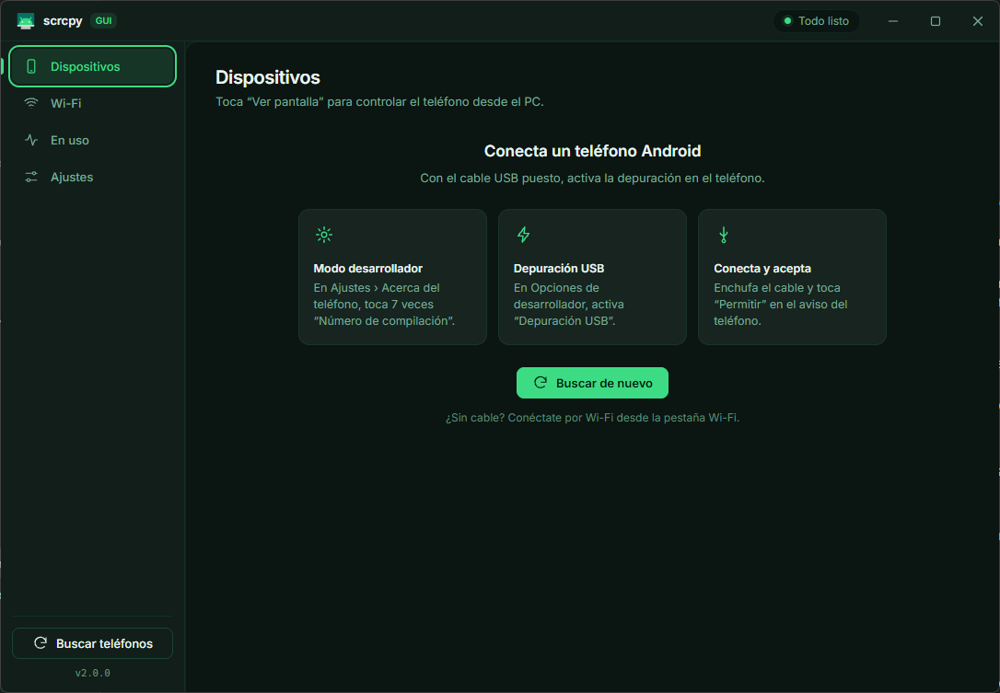
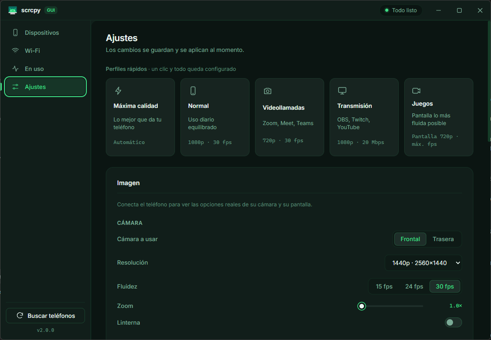

# scrcpy GUI

Interfaz gráfica para Windows de [scrcpy](https://github.com/Genymobile/scrcpy). Sirve para ver y controlar tu teléfono **Android** desde el PC y para usar su cámara como **webcam** en Zoom, Meet, Teams, Discord u OBS. Se conecta por cable o por Wi-Fi y no hace falta usar la línea de comandos.

> Interfaz independiente y **no oficial**. El motor de vídeo es el scrcpy oficial de Genymobile (Apache-2.0); esta app añade la interfaz, la cámara virtual y el ajuste automático a cada teléfono.



## Descarga e instalación

1. Descarga `scrcpy GUI_x.y.z_x64-setup.exe` de la [última versión](https://github.com/danieth-dev/scrcpy-gui/releases/latest).
2. Ejecútalo. Pide permisos de Administrador una sola vez para instalar la app y el driver de la cámara virtual **Unity Video Capture**.
3. En el teléfono, activa la **depuración USB** (Ajustes › Acerca del teléfono › toca 7 veces "Número de compilación" y luego, en Opciones de desarrollador, activa "Depuración USB").
4. Conecta el teléfono por cable y acepta el aviso "Permitir depuración USB".

El instalador ya trae scrcpy, adb y todo lo necesario. No hay que instalar nada más.

## Qué puedes hacer

- **Ver pantalla:** controla el teléfono en una ventana del PC con el ratón y el teclado. Puedes usar la resolución nativa y la frecuencia de refresco real de la pantalla (por ejemplo, 120 Hz).
- **Cámara en ventana:** muestra la cámara frontal o trasera en una ventana.
- **Cámara virtual:** el teléfono aparece como la webcam "Unity Video Capture" en cualquier programa de videollamadas o en OBS. No necesita OBS ni otros programas. Llega hasta 4K en H.265 si tu teléfono lo admite.
- **Ajustes adaptados a tu teléfono:** la app lee las resoluciones, los fps, los formatos de vídeo con aceleración por hardware, el zoom y la linterna de cada cámara y solo te ofrece lo que tu teléfono puede dar.
- **Perfiles rápidos:** Máxima calidad (automático, por defecto), Normal, Videollamadas, Transmisión y Juegos.
- **Cambios en vivo:** los ajustes se aplican al momento a lo que tengas abierto, sin cerrar la ventana ni moverla de sitio.
- **Protección del dispositivo (opcional):** vigila la temperatura y la batería y baja la calidad si el teléfono se calienta. Aunque la desactives, el freno de emergencia sigue activo.
- **Wi-Fi:** activa el Wi-Fi con el cable puesto (un clic) o vincúlalo sin cable con un código (Android 11+). Los teléfonos usados aparecen en "Usados recientemente".
- **Reconexión automática** si se corta el cable o el Wi-Fi.
- **Bandeja del sistema:** al cerrar la ventana, la app sigue en segundo plano con las sesiones abiertas.
- **Buscar actualizaciones:** desde Ajustes › Acerca de, la app comprueba en GitHub si hay una versión nueva.



## Requisitos

- Windows 10 u 11 de 64 bits, con WebView2 (viene instalado en Windows).
- Teléfono Android con depuración USB:
  - Ver pantalla: Android 5.0 o superior.
  - Cámara en ventana y cámara virtual: Android 12 o superior.
  - Vincular por Wi-Fi sin cable: Android 11 o superior.

## Rendimiento

- **Instalador:** ~12,6 MB, con scrcpy y el driver de la cámara virtual incluidos.
- **Memoria:** el proceso de la app usa ~30 MB. La interfaz corre en WebView2, el motor web de Windows, que se comparte con el sistema y añade sus propios procesos.
- **Cámara virtual:** el vídeo se decodifica dentro de la app con las librerías de FFmpeg que trae scrcpy. No usa `ffmpeg.exe` ni hay retraso añadido. Va a 1080p a 30 fps sin perder frames y llega a 4K en H.265.

## Desarrollo

Necesitas [Rust 1.80+](https://rustup.rs/), [Node.js 18+](https://nodejs.org/) y el [release oficial de scrcpy para Windows](https://github.com/Genymobile/scrcpy/releases) (`scrcpy-win64-vX.Y.zip`, descomprimido).

```bash
git clone https://github.com/danieth-dev/scrcpy-gui.git
cd scrcpy-gui
npm install
npm run vendor:sync -- "C:\ruta\a\scrcpy-win64-vX.Y"
npm run dev
```

Para generar el instalador:

```bash
npm run build
```

Queda en `src-tauri/target/release/bundle/nsis/scrcpy GUI_<versión>_x64-setup.exe`.

El código Rust está en `src-tauri/src/`:

| Archivo | Qué hace |
|---|---|
| `scrcpy.rs` | Lanza scrcpy para "Ver pantalla" y "Cámara en ventana" y lo reconecta si se corta. |
| `vcam.rs` | Cámara virtual: conexión directa con el servidor de scrcpy y envío de imágenes a Unity Capture. |
| `decoder.rs` | Decodificación de H.264/H.265 con FFmpeg y conversión de color. |
| `profile.rs` | Lee las capacidades del teléfono y elige la mejor configuración. |
| `health.rs` | Temperatura y batería del teléfono, y protección del dispositivo. |
| `adb.rs` | Detección de dispositivos y conexión por Wi-Fi. |

Para publicar una versión, sigue [docs/RELEASING.md](docs/RELEASING.md).

## Licencia

Apache License 2.0: ver [LICENSE](LICENSE) y [NOTICE](NOTICE). Los componentes de terceros incluidos en el instalador (scrcpy, FFmpeg, SDL, libusb, adb y Unity Capture) y sus licencias están en [THIRD_PARTY_LICENSES.md](THIRD_PARTY_LICENSES.md).
